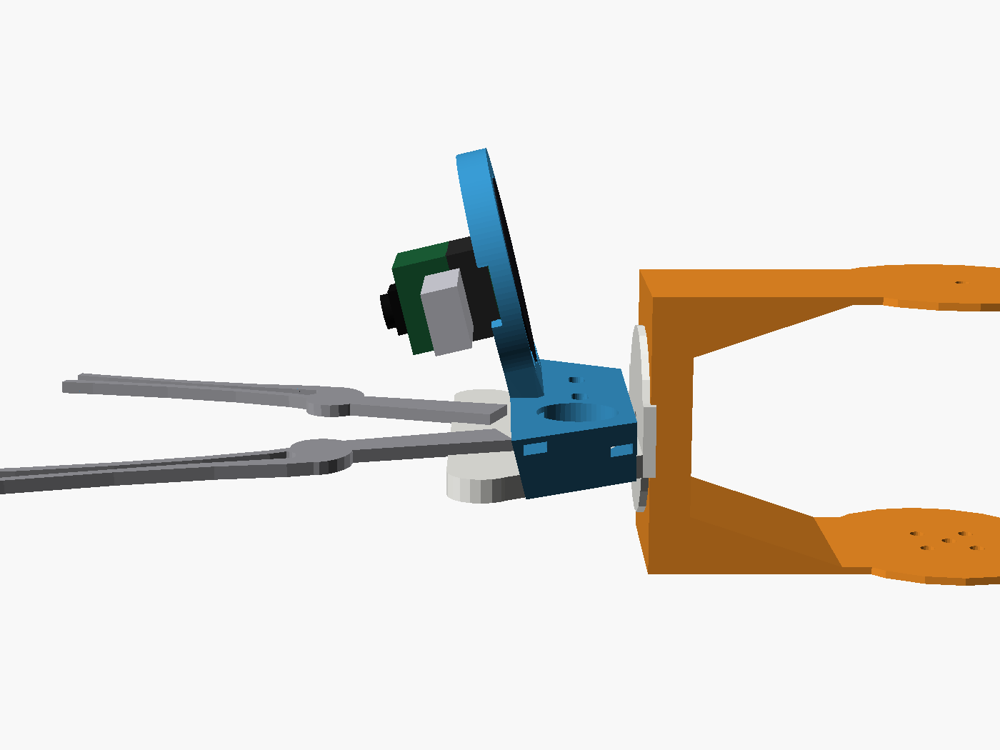
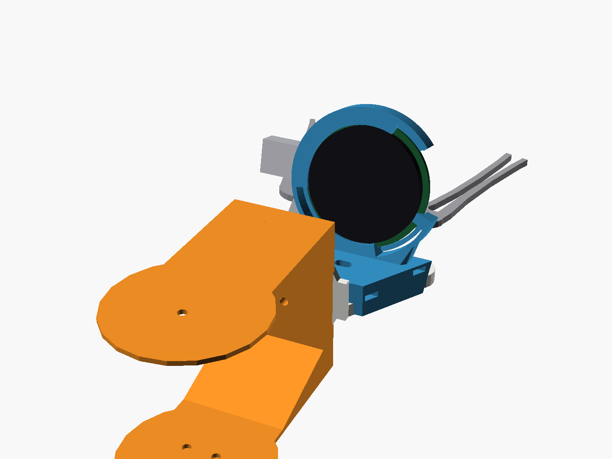
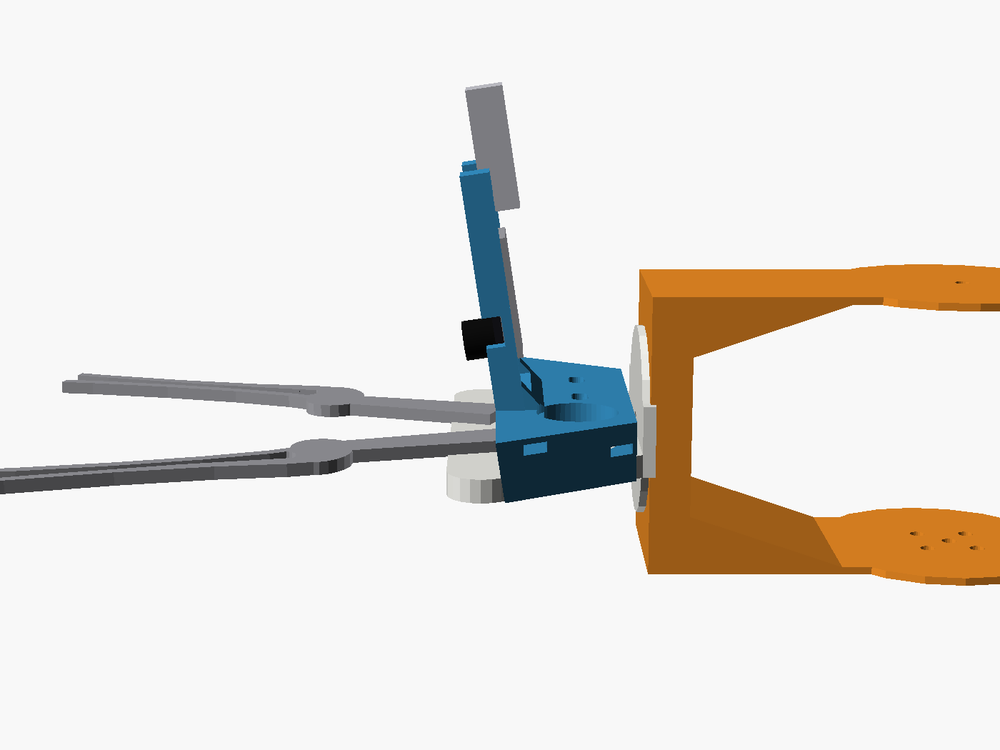
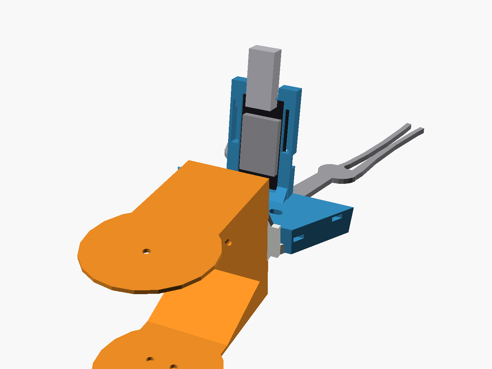

# Braccio arm model meshes (GPL-3.0)

Seven STL meshes of the TinkerKit Braccio arm, copied unmodified from

- repository: <https://github.com/lots-of-things/braccio_moveit_gazebo>
  (`braccio_description/stl/`)
- article: <https://opus.stedden.org/2020/08/braccio-moveit-gazebo/>

That repository is licensed under the **GNU General Public License v3.0**, and
so is everything in this folder. The full licence text is in
[LICENSE](LICENSE). The rest of this repository stays under the MIT licence
(top-level `LICENSE`), except `hardware/pencil-grip/`, which carries its own
CC BY-SA 4.0 licence.

## What they are

Simulation visual meshes: one simplified shape per URDF link, the ones
`sim/gazebo/urdf/braccio_sketchbot.urdf.xacro` loads. They are not the
manufacturer's part drawings and they are not print-ready arm parts. Servos,
horns, screws and the gripper linkage are not modelled, the gripper is two flat
blades, and two of the files hold more than one separate shell.

The files are in millimetres, as found. The URDF scales them by 0.001 to get
metres. Nothing here has been rescaled or repaired.

| File                        | Link               | Size (mm)              | Shells |
| --------------------------- | ------------------ | ---------------------- | ------ |
| `braccio_base.stl`          | base               | 106.5 x 106.5 x 97.0   | 3      |
| `braccio_shoulder.stl`      | shoulder           | 58.0 x 35.0 x 170.0    | 1      |
| `braccio_elbow.stl`         | elbow              | 58.0 x 35.0 x 170.0    | 1      |
| `braccio_wrist_pitch.stl`   | wrist pitch        | 57.0 x 49.0 x 85.0     | 2      |
| `braccio_wrist_roll.stl`    | wrist roll         | 77.2 x 38.0 x 40.0     | 1      |
| `braccio_left_gripper.stl`  | left gripper       | 17.7 x 2.5 x 100.9     | 1      |
| `braccio_right_gripper.stl` | right gripper      | 17.7 x 2.5 x 100.9     | 1      |

## What uses them

- `scripts/check_gripper_cameras.py` measures the two gripper-top camera
  holders against the gripper, the wrist and the forearm.
- `gripper_cameras_on_gripper.scad` draws those holders on the gripper. The
  scene and the four pictures rendered from it include these meshes, so they
  are kept in this folder under the same licence:

  | | From the side | From behind, where the audience stands |
  | --- | --- | --- |
  | XIAO round display |  |  |
  | ESP-EYE |  |  |

- `sim/render_arm.py` and the Gazebo model load the same meshes from the
  `unoq-braccio` repository; point `--meshes` here to use this copy.
