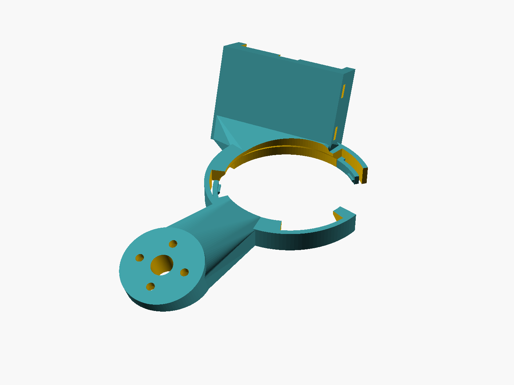

# Braccio drawing + camera tooling

The 3D-printed parts for the Sketchbot. All of them keep the exact TinkerKit
Braccio mounting interfaces, so they bolt on with the original screws.


> **Source / attribution:** *Braccio ROS2 Pencil/Pen Drawing Grip – Arduino
> UNO Q + Edge Impulse Demo* by **eoinedge**, published on Thingiverse:
> <https://www.thingiverse.com/thing:7382987>.
> Licensed **CC BY-SA 4.0** (see [LICENSE](LICENSE)). This differs from the
> repository's MIT license, which does not cover the files in this folder.

## Which part do I want?

| I want to…                                        | Print                              |
| ------------------------------------------------- | ---------------------------------- |
| Draw, and the claws can stay out of action         | `braccio_pencil_grip_8mm.stl`      |
| Draw **and** keep the claws working                | `braccio_pen_finger_8mm.stl`       |
| Put a camera on a finger, claws still working      | `braccio_camera_finger.stl`        |
| Put a camera on the wrist, both fingers free       | `braccio_wrist_camera_mount.stl`   |
| Camera and a screen on the wrist, for pick and place | `braccio_wrist_xiao_round_display.stl` |

The `_10mm` variants take thicker pens and markers; `_8mm` suits common 7–8 mm
wooden pencils.

### `braccio_pencil_grip` — rigid split collar (replaces a finger)

A split collar with an M3 screw and captive nut, in place of one Braccio
finger. The most rigid option, and the pen cannot slip — but while it is
fitted the gripper cannot hold anything.

### `braccio_pen_finger` — the same collar, beside the whole finger

The **original finger is imported whole and untouched**, claw included, with
the collar carried on one face and tied back to the blade by a web. So the
claws still close and grip; pull the pencil out (slacken the one M3 screw) and
the finger behaves exactly like a standard one.

`pen_side` picks the +y (`1`, default) or -y (`-1`) face. It has to be the
**outside** face — the one that does not meet the opposing finger — or the
claws will foul the collar. Fit it, see which way it closes, flip the sign if
needed.

### `braccio_camera_finger` — camera on a finger, claws still working

Built the same way: the untouched original finger with a camera cradle beside
it, sized for an **ESP-EYE v2.1**
(see [`../../firmware/esp_eye_camera`](../../firmware/esp_eye_camera)).


The board's 41 mm axis runs **along** the finger, USB end up towards the wrist
so the lead routes up the arm, camera end down towards the claw. The cradle is
a windowed frame rather than a box: rails capture the board's long edges, the
back plate carries a spine over the web with a pane either side, and the ESP32
module on the board's **back** face sits in that window instead of propping the
board up. Both rails are notched at the BOOT/RST plungers, the USB end is left
open for the plug body, and a 2 mm peg picks up the board's single mounting
hole to stop it creeping — the clamp screw is what actually holds it.

That took the part from **10.40 cm³ to 6.85 cm³** and the envelope from
46.4 × 25.2 mm to **38.0 × 17.8 mm**, which is the bare finger's own width: the
cradle no longer makes the part wider at all. The web that carries the camera's
mass into the blade went the other way on purpose, from a 4.5 mm strip bonded
over 39 mm² to a 13 mm plate over ~147 mm².

Change the `board_*` values for a different camera.

### `braccio_wrist_camera_mount` — the small wrist mount


Replaces the old `braccio_wrist_camera_bracket.stl` (a 56 × 44 × 49 mm,
16.6 cm³ box) with a 31 × 32 × 44 mm, 5.3 cm³ hub-arm-plate, on the **same**
mounting interface: four M2 screws on a 7 mm radius cross plus a 6.2 mm centre
bore, measured off the original bracket.

The cradle is sized for an **ESP-EYE v2.1**, like the camera finger. Two rails
capture the board's long edges and hook over its front face, the ESP32 module
on the back hangs free between them, and one M2 screw through the end brace
picks up the board's single mounting hole to stop it sliding. Change the
`board_*` values for a different camera. There is no tilt parameter: the plate
stays perpendicular to the wrist axis and the arm aims the camera by rotating
`wrist_vertical` (see `camera_poses` in `config/workspace.yaml`).

### `braccio_wrist_xiao_round_display` - camera and screen on the wrist



A cradle for a **Seeed Studio Round Display for XIAO** with a **XIAO ESP32S3
Sense** plugged into the socket on its back, the normal way round. The camera
looks out of the back of the display, past the gripper, at the point between
the claws. The screen faces the other way, towards the people watching.
Pictures of it on the wrist are in
[`../braccio-arm`](../braccio-arm/README.md), beside the arm meshes they show.

**One part, two ways to fit it.**

- *Screws.* The hub is the one `braccio_wrist_camera_mount` uses: four M2
  screws on a 7 mm radius cross and a 6.4 mm centre bore. The holder turns
  with the gripper.
- *Cable ties.* The saddle sits on one cheek of the wrist body, below the roll
  joint: pad on the cheek, a jaw round each edge so it cannot turn, a lip over
  the top so it cannot slide towards the elbow. Two ties go through tunnels in
  the pad and round the wrist, 6 mm and 20 mm below the roll joint. Each
  tunnel is 4.4 x 2.0 mm, which takes a 2.5 mm or a 3.6 mm tie. A groove down
  the middle of the pad lets the gripper servo lead pass under it. The holder
  stays with the wrist while the gripper rolls.

The two fittings are the same part turned half a turn about the camera's
optical axis and slid back along it, so the camera looks down the same line
either way. Whichever fitting is not in use carries the cable or a small LiPo:
the saddle face when the hub is screwed down, the hub when the saddle is tied
on. There is no enclosed battery pocket.

**Aim.** The optical axis crosses the gripper centre line `pick_distance` in
front of the finger mounting face (the claw tips are 61.4 mm in front of it).
The tilt follows from that.

| File | `pick_distance` | Past the closed claws | Tilt | Tie pose sits back by |
| --- | --- | --- | --- | --- |
| `braccio_wrist_xiao_round_display_near.stl` | 90 mm | 29 mm | 25.6 deg | 20.6 mm |
| `braccio_wrist_xiao_round_display.stl` | 120 mm | 59 mm | 20.7 deg | 17.6 mm |
| `braccio_wrist_xiao_round_display_far.stl` | 180 mm | 119 mm | 15.0 deg | 13.9 mm |

Any other distance: `openscad -D pick_distance=150 -o my_holder.stl
braccio_wrist_xiao_round_display.scad`.

**Dimensions and where they come from.** All of these are named values at the
top of the source.

| Value | mm | Source |
| --- | --- | --- |
| Display board diameter | 43.1 | Seeed board file v1.1 (outline radius 21.53) |
| Battery connector, switch, card slot, flex notch positions | angles 0, 153.8, 180, 90 deg | Seeed board file v1.1 |
| XIAO socket height | 5.0 | Seeed board file v1.1 (package name) |
| XIAO centre from display centre | 9.65 | Seeed board file v1.1 |
| Cover glass diameter | 39.0 | Seeed wiki ("39mm disc") |
| XIAO board | 21.0 x 17.8 | Seeed wiki |
| XIAO with camera board, height | 15.0 | Seeed wiki |
| Hub: hole circle, holes, counterbore, bore | 7.0 radius, 2.4, 5.6 x 1.6, 6.4 | `braccio_wrist_camera_mount.scad` |
| Finger mounting face above the roll frame origin | 30.0 | URDF |
| Claw tips in front of the mounting face | 61.4 | `braccio_grip_lib.scad` |
| Wrist body: width across the cheek, cheek face from the roll axis, top face | 35.0, 29.0, 1.0 | `../braccio-arm/braccio_wrist_pitch.stl` |
| Horn disc top | 2.62 | `../braccio-arm/braccio_wrist_roll.stl` |
| Display board thickness | 1.6 | **Estimate** (cavity step in Seeed's printed case) |
| Glass face above the board's front face | 3.0 | **Estimate** |
| Pin header plastic under the XIAO | 2.5 | **Estimate** |
| Lens from the display centre, towards the USB-C end | 15.0 | **Estimate** (Seeed's 3D model picture) |
| USB-C plug body | 22 x 12 x 7 | **Estimate** |
| Camera field of view | 66 deg | **Estimate** (OV2640; later units ship other sensors) |

Sources: Seeed's board file
<https://files.seeedstudio.com/wiki/round_display_for_xiao/SeeedStudio_Round_Display_for_XIAO_v1.1_SCH&PCB_230407.zip>,
Seeed's printed case
<https://files.seeedstudio.com/wiki/round_display_for_xiao/Seeed_Studio-XIAO-ESP32-S3-Sense-Case-With-Round-Screen.stl>,
<https://wiki.seeedstudio.com/get_start_round_display/> and
<https://wiki.seeedstudio.com/xiao_esp32s3_getting_started/>.

The wrist and horn values are taken from simulation meshes, not from the arm
itself. Measure your wrist body across the cheek and from the cheek to the
roll axis before printing, and set `wrist_width` and `wrist_face_y` to match.

**The cradle.** The board's front rim seats on a 45 degree bevel behind a
40 mm opening, so the glass and the touch surface are left clear. Three sprung
latches click over the back of the board; each works in a slot, with an
unbroken band of the ring outside it. The rear of the ring is cut away at the
JST battery connector, and there is a gap right through the ring at the slide
switch and the microSD slot. Nothing stands behind the board, so the camera,
the XIAO and the USB-C plug are in the open. Clearances: 0.3 mm round the
board, 0.25 mm between the board and the latch hooks, 0.7 mm of hook over the
rim, 0.4 mm each side of the wrist body in the saddle. Ring wall 4.0 mm.

**Print.**

1. Print `braccio_wrist_xiao_round_display_fit_test.stl` (51.7 mm across,
   6.2 mm tall) and press the display into it from the back, screen first.
2. If it is tight or loose, change `board_fit`, `display_pcb_thick` or
   `board_slack` and export again. Check the other estimates in the table
   against your boards while you are there.
3. Print the holder as exported: rear rim of the ring on the bed, screen side
   up, 61 x 103 x 30 mm. PETG or PLA, 0.2 mm layers, 4 walls, 30 to 40 percent
   infill, no supports. The only bridge is 12 mm, over the battery notch. The
   hub's mating face prints as a shallow slope; a light rub on abrasive paper
   flattens the layer steps.

**Assemble, with screws.**

1. Fit the hub where the ESP-EYE wrist mount goes, with the same four M2
   screws. Turn it so the ring is on the side away from the pen collar.
2. Press the display in, USB-C end at the notch in the rear of the ring next
   to the saddle.
3. Tie the cable to the saddle face with a 2.5 mm tie through a tunnel, and
   leave a loop long enough for the wrist to roll a quarter turn each way. A
   small LiPo sits on the same face.

**Assemble, with cable ties.**

1. Turn the holder round so the saddle meets the wrist body: pad on one cheek,
   lip on top.
2. Lay the gripper servo lead in the groove, or keep it outside the ties.
3. Thread a tie through each tunnel and round the wrist, pull tight, trim.
   You need about 250 mm of tie.
4. Tie the cable or the battery to the hub, which now stands clear outside.

**Parts list.** Round Display for XIAO; XIAO ESP32S3 Sense with soldered pin
headers; 4 x M2 screws or 2 x cable ties (2.5 or 3.6 mm wide, 250 mm or
longer); a USB-C cable or a LiPo with a JST 1.25 plug; one 2.5 mm tie.

**Clearances.** `scripts/check_xiao_holder.py` exports the holder in both
poses and measures the smallest gap to the reference geometry: the meshes in
`../braccio-arm` placed with the URDF's joint frames, and
`braccio_pen_finger_8mm.stl` where the URDF puts it. Gripper open to closed,
wrist roll and wrist pitch each -90 to 90 degrees. Smallest gap in mm:

| | near | default | far |
| --- | --- | --- | --- |
| Screws: gripper base, outside the hub | 2.3 | 2.1 | 1.9 |
| Screws: fingers, holder and boards | 10.1 | 11.6 | 13.3 |
| Screws: pen finger | 8.9 | 12.3 | 15.5 |
| Screws: wrist body over the roll range, outside the hub | 3.8 | 3.6 | 3.4 |
| Screws: forearm | 40.5 | 40.5 | 40.5 |
| Ties: gripper base and fingers over the roll range, holder | 4.3 | 4.3 | 4.3 |
| Ties: gripper base and fingers over the roll range, boards and plug | 0.9 | 3.2 | 5.9 |
| Ties: tie bands to anything that rolls | 4.2 | 4.2 | 4.2 |
| Ties: forearm | 14.4 | 14.4 | 14.4 |
| Ties: roll angles with a clear line to the pick point | -60 to 80 | -85 to 80 | -85 to 85 |

Three things to read into that. The hub itself sits on the horn 1.6 mm above
the wrist body, as the existing mount does, and the reference gripper plate
passes through the hub's footprint: the meshes do not model the horn
interface, so the check leaves the hub out. The gaps under 2.5 mm at the
gripper base are the underside of the arm leaving the horn. And tied on, the
near holder brings the USB-C plug within 0.9 mm of a fully open claw at a
quarter turn of roll; use the default or far holder with ties, or a
right-angle plug. With screws the camera has a clear line to the pick point at
every gripper opening; with ties the claws cross it near a quarter turn.

**Software.** This is a holder. `firmware/esp_eye_camera` is for the ESP-EYE
and does not run on a XIAO ESP32S3 Sense as it stands. Zephyr firmware for
this board pair that shows the camera crop, an MNIST digit and the inference
time on the round display is in
<https://github.com/eoinjordan/executorch-zephyr-xiao-esp32s3>; it does not
talk to the Studio. Streaming this camera to the Studio: not written. Showing
detections on the screen while streaming: not written.

## Files

| File                                | Purpose                                      |
| ----------------------------------- | -------------------------------------------- |
| `braccio_grip_lib.scad`             | Shared clamp + finger geometry.               |
| `braccio_pencil_grip.scad`          | Split collar that replaces a finger.          |
| `braccio_pen_finger.scad`           | Collar beside the whole finger.               |
| `braccio_camera_finger.scad`        | Camera cradle beside the whole finger.        |
| `braccio_wrist_camera_mount.scad`   | Minimal wrist camera mount.                   |
| `braccio_wrist_xiao_round_display.scad` | XIAO round display holder; `_near`, `_far` and `_fit_test` STLs come from it. |
| `*_8mm.scad` / `*_10mm.scad`        | Bore-size presets; the geometry lives above.  |
| `*.stl` / `*.obj`                   | Rendered meshes, regenerated from the source. |
| `braccio_mount_reference_mm.stl`    | The original Braccio finger — **required** by the SCAD. |
| `braccio_camera_mount.stl`          | Older end-effector camera mount (replaces a finger). |
| `braccio_wrist_camera_bracket.stl`  | The older, bulkier wrist bracket.             |

Every STL is validated in CI (`tests/test_hardware_meshes.py`): closed,
manifold, one shell, and small enough for a hobby printer.

```bash
python scripts/mesh_check.py hardware/pencil-grip/*.stl
```

## Regenerating the meshes

The shipped STLs are rendered straight from the SCAD source — don't hand-edit
them:

```bash
scripts/render_hardware.sh
```

That renders every preset, converts to binary STL, writes the OBJ copies, and
re-runs the validation. Override `OPENSCAD=` / `PYTHON=` if they are not on
your `PATH`. For a one-off size:

```bash
openscad -o my_grip.stl -D pencil_diameter=9 braccio_pencil_grip.scad
```

## Hardware

- 1 × M3 socket-head screw, 16–20 mm long, and 1 × M3 hex nut (per clamp)
- 4 × M2 screws for the wrist camera mount (reuse the bracket's); the XIAO
  round display holder uses the same four, or two cable ties instead
- The original Braccio finger mounting screws

## Print settings

- Material: **PETG preferred** (best clamp flex); PLA+ also fine.
- Layer height: 0.20 mm.
- Walls: 4 · Top/bottom: 5 · Infill: 30–40 % gyroid or cubic.
- Supports: build-plate supports may be needed under the collar/shoulder.

## Assembly

1. Print the size you need (mounting face on the plate, or on its side with
   supports under the collar).
2. Press the M3 nut into the captive hex pocket.
3. Fit the M3 screw loosely through the opposite clamp ear.
4. Mount the part with the original Braccio finger screws.
5. Insert the pencil until it bottoms out in the bore — the bore is blind on
   purpose, so the tip ends up the same distance out every time, which is what
   makes `wrist_pen_mm` repeatable.
6. Tighten the M3 screw just enough to stop slipping — don't crush a wooden
   pencil.

## Wiring it into the Sketchbot software

The pen is **rigidly clamped** (not held by the gripper), so:

- Set `links.wrist_pen_mm` in [`../../config/workspace.yaml`](../../config/workspace.yaml)
  to the wrist-axis-to-tip distance. The SCAD echoes the number when you render
  it: 90 mm from the wrist axis to the finger mounting face (from the URDF),
  plus the collar length, plus however far the pencil sticks out. For
  `braccio_pencil_grip` that is about **174 mm**.
- **Then re-run the workspace check.** A long pen pushes the wrist point high,
  which shrinks the drawable area sharply — the elbow and wrist servos only
  bend ±90° from in line, so the drawable region is a fairly narrow annulus:

  ```bash
  python scripts/check_workspace.py --suggest
  ```

  It prints the largest paper box that actually fits and refuses to let you
  configure one that does not (the planner silently *skips* moves it cannot
  solve, so an oversized box just loses strokes). Standing the arm on a ~60 mm
  riser, or hanging the paper below the base plane, roughly doubles the box.
- `pen.down_gripper` just sets a neutral finger angle; the screw holds the tool.
- There is no built-in Z compliance. Tune `pen.down_z_mm` carefully and keep
  downward force light.

## A note on the source

An earlier revision's STLs did not match the SCAD: rendering the source
produced a mesh with two stray 0.5 mm shells (inherited from the reference
finger) and a non-manifold edge, while the shipped STLs had been repaired
externally. The reference mesh is now clean, `scripts/render_hardware.sh`
regenerates everything from source, and the test suite checks it stays that
way. The clamp also had only 0.8 mm of material behind the screw head; the
clamp lug is now hulled onto the collar with ≥2 mm webs, and the collar wall is
parametric (3.4 mm by default) so it can actually flex closed — which also took
the 8 mm grip from 15.9 cm³ down to 9.9 cm³ of plastic hanging off the wrist.
