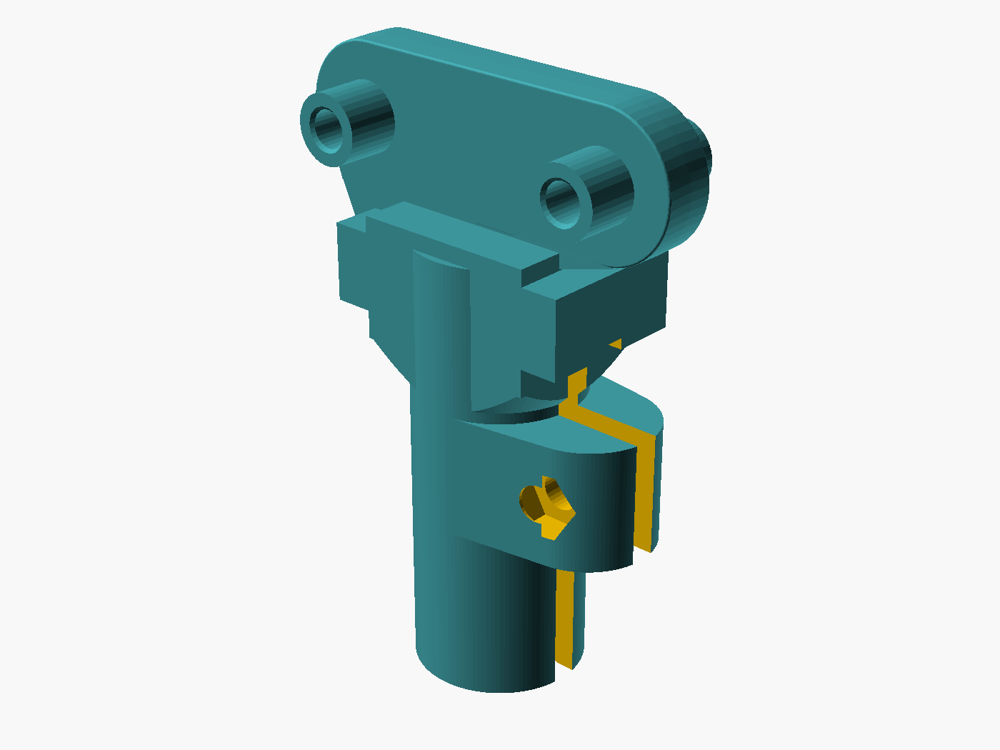
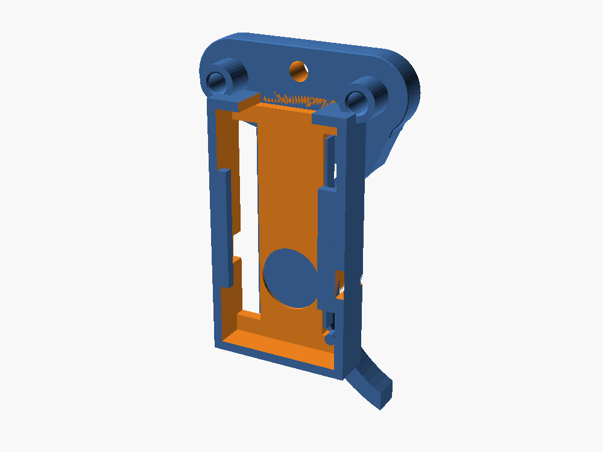
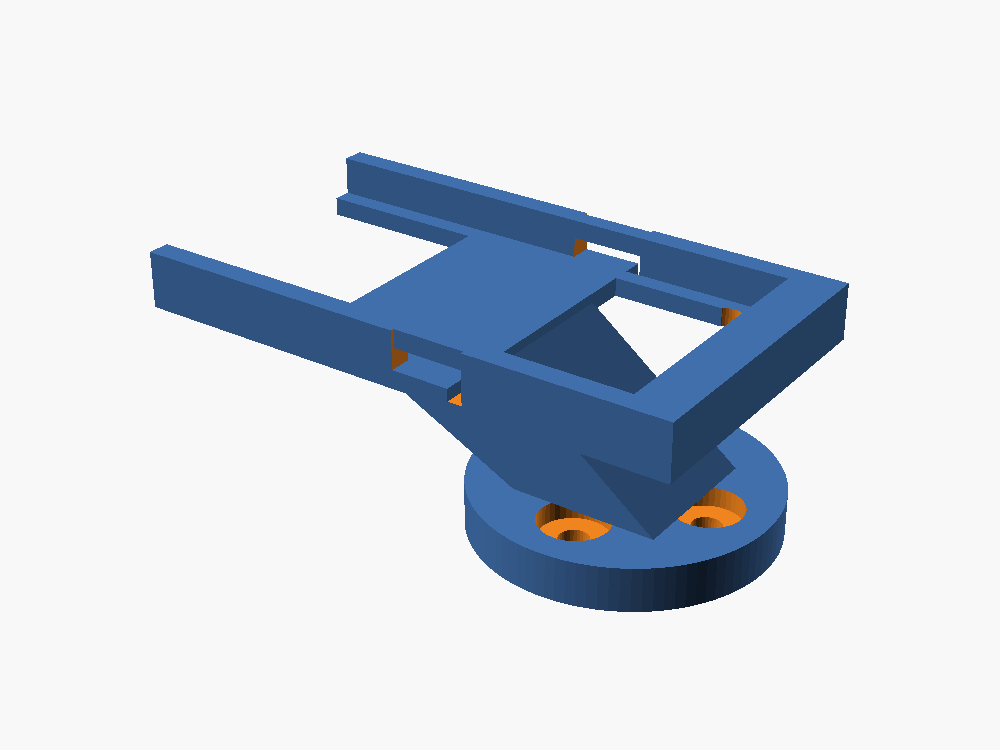
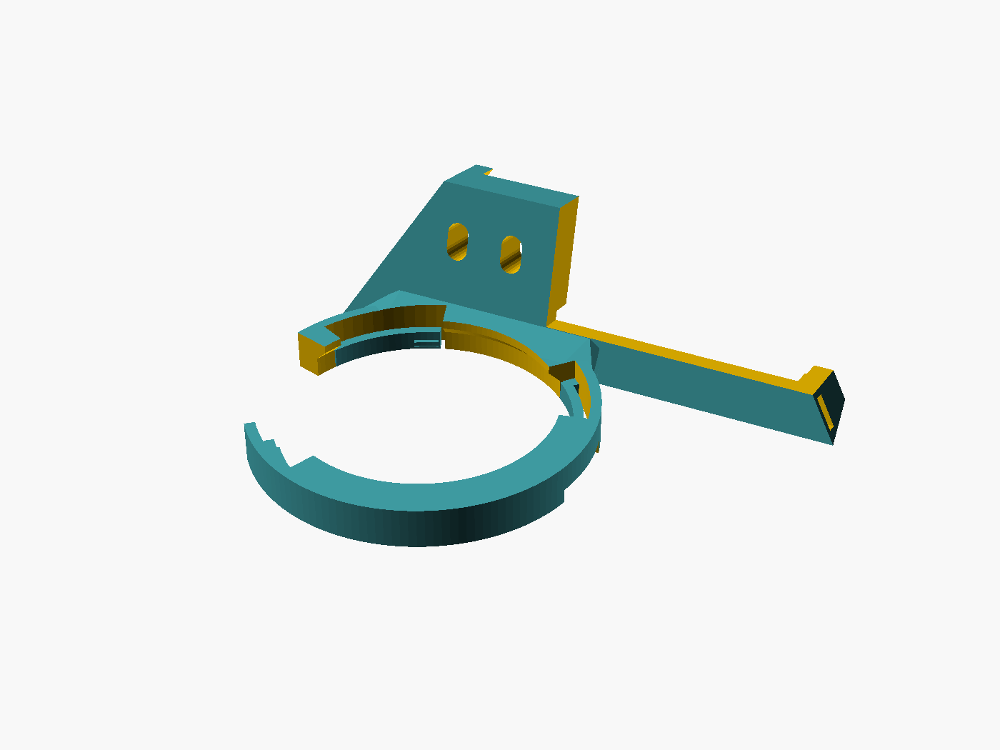
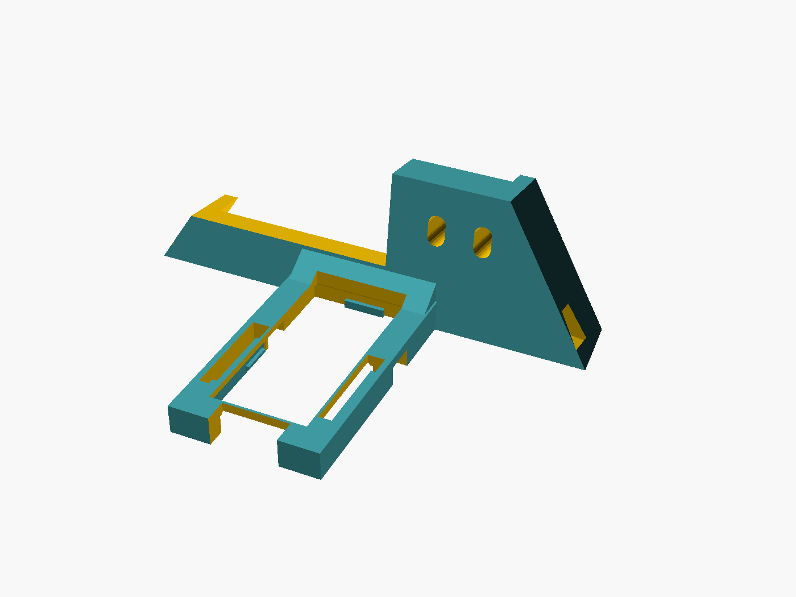
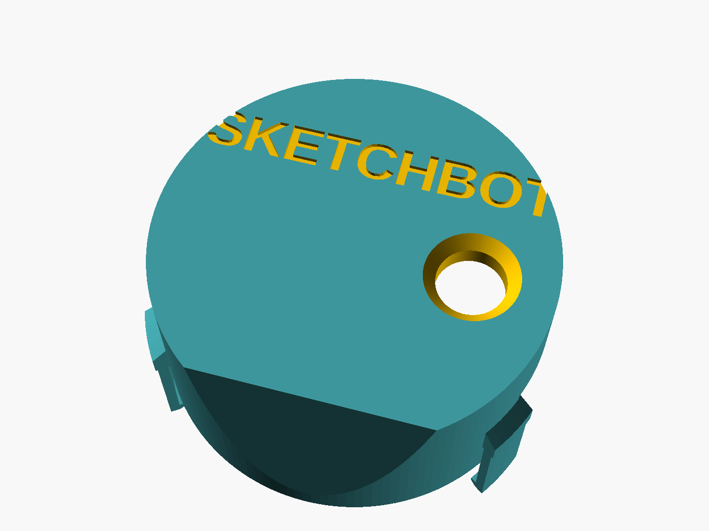

# Braccio drawing + camera tooling

The 3D-printed parts for the Sketchbot. All of them keep the exact TinkerKit
Braccio mounting interfaces, so they bolt on with the original screws.



> **Source / attribution:** *Braccio ROS2 Pencil/Pen Drawing Grip – Arduino
> UNO Q + Edge Impulse Demo* by **eoinedge**, published on Thingiverse:
> <https://www.thingiverse.com/thing:7382987>.
> Licensed **CC BY-SA 4.0** (see [LICENSE](LICENSE)). This differs from the
> repository's MIT license, which does not cover the files in this folder.

## Which part do I want?

| I want to…                                        | Print                              |
| ------------------------------------------------- | ---------------------------------- |
| Draw, and the claws can stay out of action         | `braccio_pencil_grip_8mm.stl`      |
| Draw **and** keep the claws working                | `braccio_pen_finger_8mm.stl`       |
| Put a camera on a finger, claws still working      | `braccio_camera_finger.stl`        |
| Put a camera on the wrist, both fingers free       | `braccio_wrist_camera_mount.stl`   |
| Camera on top of the gripper, with a screen, for pick and place | `braccio_gripper_xiao_round_display.stl` |
| ESP-EYE on top of the gripper, for pick and place | `braccio_gripper_esp_eye.stl` |

The `_10mm` variants take thicker pens and markers; `_8mm` suits common 7–8 mm
wooden pencils.

### `braccio_pencil_grip` — rigid split collar (replaces a finger)

A split collar with an M3 screw and captive nut, in place of one Braccio
finger. The most rigid option, and the pen cannot slip — but while it is
fitted the gripper cannot hold anything.

### `braccio_pen_finger` — the same collar, beside the whole finger

The **original finger is imported whole and untouched**, claw included, with
the collar carried on one face and tied back to the blade by a web. So the
claws still close and grip; pull the pencil out (slacken the one M3 screw) and
the finger behaves exactly like a standard one.

`pen_side` picks the +y (`1`, default) or -y (`-1`) face. It has to be the
**outside** face — the one that does not meet the opposing finger — or the
claws will foul the collar. Fit it, see which way it closes, flip the sign if
needed.

### `braccio_camera_finger` — camera on a finger, claws still working

Built the same way: the untouched original finger with a camera cradle beside
it, sized for an **ESP-EYE v2.1**
(see [`../../firmware/esp_eye_camera`](../../firmware/esp_eye_camera)).



The board's 41 mm axis runs **along** the finger, USB end up towards the wrist
so the lead routes up the arm, camera end down towards the claw. The cradle is
a windowed frame rather than a box: rails capture the board's long edges, the
back plate carries a spine over the web with a pane either side, and the ESP32
module on the board's **back** face sits in that window instead of propping the
board up. Both rails are notched at the BOOT/RST plungers, the USB end is left
open for the plug body, and a 2 mm peg picks up the board's single mounting
hole to stop it creeping — the clamp screw is what actually holds it.

That took the part from **10.40 cm³ to 6.85 cm³** and the envelope from
46.4 × 25.2 mm to **38.0 × 17.8 mm**, which is the bare finger's own width: the
cradle no longer makes the part wider at all. The web that carries the camera's
mass into the blade went the other way on purpose, from a 4.5 mm strip bonded
over 39 mm² to a 13 mm plate over ~147 mm².

Change the `board_*` values for a different camera.

### `braccio_wrist_camera_mount` — the small wrist mount




Replaces the old `braccio_wrist_camera_bracket.stl` (a 56 × 44 × 49 mm,
16.6 cm³ box) with a 31 × 32 × 44 mm, 5.3 cm³ hub-arm-plate, on the **same**
mounting interface: four M2 screws on a 7 mm radius cross plus a 6.2 mm centre
bore, measured off the original bracket.

The cradle is sized for an **ESP-EYE v2.1**, like the camera finger. Two rails
capture the board's long edges and hook over its front face, the ESP32 module
on the back hangs free between them, and one M2 screw through the end brace
picks up the board's single mounting hole to stop it sliding. Change the
`board_*` values for a different camera. There is no tilt parameter: the plate
stays perpendicular to the wrist axis and the arm aims the camera by rotating
`wrist_vertical` (see `camera_poses` in `config/workspace.yaml`).

### Cameras on top of the gripper

Two holders that put a camera where it sees what the claws are about to grab:
on the flat face of the gripper block, just behind the finger pivots, looking
forward along the fingers. The lens is on the gripper's plane of symmetry and
tilted down so that its optical axis meets the gripper centre line at the pick
point. Because the holder is on the gripper block it follows wrist roll.

| | |
| --- | --- |
|  |  |
| `braccio_gripper_xiao_round_display`: a Seeed Studio Round Display for XIAO with a XIAO ESP32S3 Sense on its back. It stands up like a small round face: lens forward, screen directly behind it, facing back up the arm towards the audience. | `braccio_gripper_esp_eye`: an ESP-EYE v2.1, upright, camera end down and USB end up, lens forward. |

Pictures of both on the gripper, from the side and from where the audience
stands, are in [`../braccio-arm`](../braccio-arm/README.md), beside the arm
meshes they show.

**The saddle** (`braccio_gripper_camera_lib.scad`, shared by both). A pad on
the face of the gripper block with a jaw down each sloping side edge. The
block widens towards the fingers, so the jaws stop the pad sliding forward and
stop it twisting; the tie or the screws stop it sliding back. In front of
z = 21.5 mm the pad is a bridge that passes over the finger bases.

- *Servo slot.* The gripper servo stands proud of the block, so the pad does
  not try to cover it. An open-ended slot is cut right through the pad and the
  jaw, from one side edge inwards: the servo body, its ears, its horn and its
  lead all sit in the open, and the lead leaves through the open end. The
  defaults are the SR311's published body (31.3 x 16.5 x 28.6 mm, from
  <https://store-usa.arduino.cc/products/tinkerkit-braccio-robot>) with
  margin: 42 mm long, 21 mm wide, centred 18 mm behind the finger pivots,
  and nothing is built over it below 30 mm. The slot is open to the
  **right-hand edge, seen from behind the gripper looking along the fingers
  with the camera on top**. That side comes from a test fit on the owner's
  gripper; the first version had it on the left. `servo_side = 1` turns it
  back to the left.
- *Cable tie.* One tunnel, **5.0 x 2.6 mm**, for a 2.5 mm or a 3.6 mm tie
  (3.6 x 1.4 mm with 0.7 mm each side and 0.6 mm above and below), in the
  strip of pad between the servo slot and the finger pivots. It runs straight
  through from one side face of the pad to the other, has at least 1.2 mm of
  material all round and flares by 1.5 mm at both mouths so a tie feeds in.
  The tie goes round the block there and never crosses the servo, its horn or
  the finger linkage. A second tunnel appears behind the slot if
  `servo_from_pivots` leaves room for one; with the defaults it does not.
  `scripts/check_tie_tunnels.py` probes every exported STL for a clear
  passage, and `tests/test_tie_tunnels.py` fails if one is blocked. The first
  version's tunnel was 4.4 x 2.0 mm with a 0.7 mm floor.
- *Screws.* Two slots through the pad for M3 screws. **None of the references
  these parts are drawn from shows a fixing point on the gripper block**, so
  the slot positions are placeholders. Measure two holes or studs on your
  block and set `screw_spacing`, `screw_centre_x` and `screw_z`.

**Four things to measure on your gripper.** No dimensioned drawing or CAD of
the Braccio gripper was found; Arduino's store page gives only the arm's
overall sizes. The block's numbers are read off
`../braccio-arm/braccio_wrist_roll.stl`, a simulation mesh that draws the
whole block as a 4.5 mm plate with a round hole where the servo goes. Two of
the defaults were then changed after a test fit of a printed saddle on the
owner's gripper: the opening between the jaws is 2 mm wider each side
(`block_half_width` 20.8 to 22.8, the jaws moved out, not thinned), and the
servo slot is on the other edge. Nothing else here has been fitted.

| Measure | Set |
| --- | --- |
| Width of the block's face at both ends | `block_half_width` (at `block_ref_z`) and `block_taper` |
| Thickness of the block | `block_thickness` |
| Servo body length and width, and how far it stands above the face | `servo_slot_length`, `servo_slot_width`, `servo_stand_height` |
| Finger pivots to the middle of the servo | `servo_from_pivots` |

Then print `braccio_gripper_saddle_fit_test.stl` (85 x 13 x 26 mm as it
prints, standing on its front end): the saddle alone, with the slot, the tie
tunnel and the screw slots but no camera. Try it on the gripper, open and
close the claws under it, and thread a tie through, before printing a holder.

**The cover** (round display holder only; `part = "cover"`). A cup over the
lens side that encloses the XIAO, the camera board and a small LiPo, with
SKETCHBOT let into its face.



- *Fixing.* Four sprung arms reach past the outside of the ring and hook
  0.6 mm over its screen-side edge. No tools, and the holder has no matching
  feature, so the ring is unchanged. Lever the arms out with a fingernail to
  take the cover off; the display comes out as before.
  `braccio_gripper_xiao_round_display_cover_fit_test.stl` is the rim and the
  four arms alone, to try the snap on the ring.
- *Lens.* A collar round the camera barrel (9 mm bore for the 7 mm barrel)
  steadies the camera board. The window widens at 45 degrees from the collar.
  Its edge is 33.9 degrees outside the corner of a 66 degree picture seen
  from the centre of the lens, and 12.0 degrees outside it seen from the rim
  of the barrel. The check finds none of the cover in the picture.
- *Battery.* A pocket between two ribs for a LiPo standing on its long edge
  beside the XIAO, closed by the cover's face and the back of the display.
  The defaults are for a **402030** cell (4.0 x 20 x 30 mm, about 200 mAh).
  **Measure your cell** and set `battery_t`, `battery_w` and `battery_l`; a
  cell wider than 20 mm makes the cover deeper.
- *Openings.* One slot at the USB-C end, 19 x 12.5 mm, for the plug, the
  battery lead and a pin to the XIAO's buttons. The display's JST connector
  is under the USB-C socket and its plug goes in from the rim, so the lead
  leaves by this slot and turns back to the connector. Two small slots beside
  it take a 2.5 mm tie as strain relief. Four vent slots along the top let
  heat out and keep the microphone and the LED from being sealed in. The
  display's slide switch and card slot are in the ring, below the cover, and
  stay reachable.
- *Lettering.* `cover_text`, in Liberation Sans Bold (bundled with OpenSCAD),
  5.5 mm high, **recessed** 0.6 mm. Recessed because the cover prints face
  down, where raised letters would need supports.
- *One per aim distance.* The cup is cut flat underneath, 0.8 mm above the
  space left for the finger bases, so its shape follows the tilt: use
  `_near_cover` with `_near`, `_cover` with the default and `_far_cover` with
  `_far`.

The ESP-EYE holder has no cover. Its lens side carries the latches and the
fixed hook, so a cover would need snap features of its own and a frame
change; it is not a small addition and was not done.

**Aim.** `pick_distance` is measured in front of the finger mounting face; the
claw tips are 61.4 mm in front of it. `camera_height` (optical axis above the
gripper centre line where it leaves the holder) and `face_z` (how far along
the gripper the holder stands) are the height and setback. The defaults are as
low as each board allows. The tilt follows.

| File | `pick_distance` | Past the closed claws | Tilt | Lens above the centre line | Lens in front of the finger mount |
| --- | --- | --- | --- | --- | --- |
| `braccio_gripper_xiao_round_display_near.stl` | 90 mm | 29 mm | 19.3 deg | 21.6 mm | 28.3 mm |
| `braccio_gripper_xiao_round_display.stl` | 120 mm | 59 mm | 14.6 deg | 23.7 mm | 29.0 mm |
| `braccio_gripper_xiao_round_display_far.stl` | 180 mm | 119 mm | 9.8 deg | 25.9 mm | 29.5 mm |
| `braccio_gripper_esp_eye_near.stl` | 90 mm | 29 mm | 12.4 deg | 17.8 mm | 9.1 mm |
| `braccio_gripper_esp_eye.stl` | 120 mm | 59 mm | 9.4 deg | 18.3 mm | 9.2 mm |
| `braccio_gripper_esp_eye_far.stl` | 180 mm | 119 mm | 6.3 deg | 18.9 mm | 9.2 mm |

The XIAO's camera is 15 mm off the centre of the display, towards the USB-C
end. To keep the lens on the plane of symmetry the display sits 15 mm to one
side, with the USB-C socket pointing across the gripper.

Any other distance: `openscad -D pick_distance=150 -o my_holder.stl
braccio_gripper_esp_eye.scad`.

**Dimensions and where they come from.** All are named values in the sources.

| Value | mm | Source |
| --- | --- | --- |
| Display board diameter | 43.1 | Seeed board file v1.1 (outline radius 21.53) |
| Battery connector, switch, card slot, flex notch positions | angles 0, 153.8, 180, 90 deg | Seeed board file v1.1 |
| XIAO socket height | 5.0 | Seeed board file v1.1 (package name) |
| XIAO centre from display centre | 9.65 | Seeed board file v1.1 |
| Cover glass diameter | 39.0 | Seeed wiki ("39mm disc") |
| XIAO board | 21.0 x 17.8 | Seeed wiki |
| XIAO with camera board, height | 15.0 | Seeed wiki |
| ESP-EYE board outline | 41.0 x 21.0 | distributor listings of Espressif's figures; same as the existing ESP-EYE mounts here |
| ESP-EYE lens from the USB edge, barrel, module, buttons | 29.5, 7 x 6.5, 3.3, 26.0 | `braccio_camera_finger.scad` (measured there off `docs/images/esp-eye.png`) |
| Finger mounting face above the roll frame origin | 30.0 | URDF |
| Claw tips in front of the mounting face | 61.4 | `braccio_grip_lib.scad` |
| Gripper block: face, thickness, taper | y -1.5, 4.5, 0.612 per mm | `../braccio-arm/braccio_wrist_roll.stl` |
| Gripper block: half width at z 3.1 | 22.8 | test fit on the owner's gripper (the mesh gives 20.8) |
| Gripper servo side | right-hand edge, seen from behind | test fit on the owner's gripper |
| Gripper servo (SR311) body | 31.3 x 16.5 x 28.6 | Arduino store page; slot defaults add margin |
| Servo position: pivots to the middle of the slot | 18.0 | **Estimate** (the mesh's hole is 15.0 behind the pivots) |
| LiPo cell for the cover | 4.0 x 20 x 30 (402030) | **Default, not a measurement**: set to your cell |
| Tallest part on the back of the display | 3.2 | **Estimate** (RTC cell holder, 2.9 in the board file) |
| Finger blades: reach back to, stand above the centre line | z 23.5, y 0.7 | `../braccio-arm` gripper meshes, swept open to closed |
| Display board thickness | 1.6 | **Estimate** (cavity step in Seeed's printed case) |
| Glass face above the board's front face | 3.0 | **Estimate** |
| Pin header plastic under the XIAO | 2.5 | **Estimate** |
| XIAO lens from the display centre, towards the USB-C end | 15.0 | **Estimate** (Seeed's 3D model picture) |
| USB plug bodies | 22 x 12 x 7 (USB-C), 20 x 11 x 7 (micro-USB) | **Estimate** |
| Camera field of view | 66 deg | **Estimate** (OV2640) |

Sources: Seeed's board file
<https://files.seeedstudio.com/wiki/round_display_for_xiao/SeeedStudio_Round_Display_for_XIAO_v1.1_SCH&PCB_230407.zip>,
Seeed's printed case
<https://files.seeedstudio.com/wiki/round_display_for_xiao/Seeed_Studio-XIAO-ESP32-S3-Sense-Case-With-Round-Screen.stl>,
<https://wiki.seeedstudio.com/get_start_round_display/>,
<https://wiki.seeedstudio.com/xiao_esp32s3_getting_started/>,
<https://www.espressif.com/en/products/devkits/esp-eye/resources> and
<https://wiki.dfrobot.com/ESP-EYE%20Development%20Board%20SKU:%20DFR0620>.
Espressif's own ESP-EYE layout files (the reference design archive on its
resources page) were not opened for these parts, so every ESP-EYE feature
position is a measurement to repeat on your board.

**How the boards are held.**

- *Round display.* The board's front rim seats on a 45 degree bevel behind a
  40 mm opening, so the glass and the touch surface are clear. Three sprung
  latches click over the back; each works in a slot with an unbroken band of
  the ring outside it. The rear of the ring is cut away at the JST battery
  connector and there is a gap right through it at the slide switch and the
  microSD slot. The XIAO, the lens and the USB-C plug are in the open.
- *ESP-EYE.* The board's back rim rests on a bevelled ledge round a window
  that leaves the ESP32 module and the USB socket clear. A fixed hook catches
  the camera end of the front face and two sprung latches click over the long
  edges near the USB end. The frame is open in the middle of the USB end for
  the plug and cut away beside BOOT and RST.

Clearances: 0.3 mm round each board, 0.25 mm between board and hooks, 0.7 mm
of hook over the rim, 0.4 mm each side of the gripper block, 1.5 mm over the
finger bases, 0.2 mm between the cover and the ring, 0.3 mm between the
cover's arms and the ring.

**Print.**

1. Print the fit piece for your camera:
   `braccio_gripper_xiao_round_display_fit_test.stl` (51.7 mm across, 6.2 mm
   tall) or `braccio_gripper_esp_eye_fit_test.stl` (28.8 x 49.6 x 5.7 mm).
   For the cover, `braccio_gripper_xiao_round_display_cover_fit_test.stl`.
   Press the board in. The display goes in from the back, screen first. The
   ESP-EYE goes in back first: camera end under the fixed hook, then the USB
   end past the two latches.
2. If it is tight or loose, change `board_fit` or `board_slack` and export
   again. Check the estimates in the table against your board.
3. Measure the gripper block and set its values (above).
4. Print the holder as exported, lens side on the bed, and the cover as
   exported, face down. PETG or PLA, 0.2 mm layers, 4 walls, 30 to 40 percent
   infill, no supports. PETG suits the cover's snap arms better.

**Assemble, with cable ties.**

1. Sit the saddle on the top face of the gripper block, jaws down the two
   sloping edges, and push it forward until the jaws are snug.
2. Thread a tie through the tunnel and round the block, just behind the
   finger pivots and in front of the servo. About 200 mm of tie.
3. Keep the gripper servo lead outside the ties. Open and close the claws by
   hand to see that nothing rubs, then pull the ties tight and trim them.
4. Press the board in and plug in the cable, with slack for the wrist to roll.
5. Round display: put the cell in the cover's pocket, bring its lead out of
   the plug slot and into the JST connector under the USB-C socket, and push
   the cover on until the four arms click over the edge of the ring.

**Assemble, with screws.** Set the three `screw_*` values from your gripper
block, print, and fix the pad with two M3 screws through the slots.

**Parts list.** A Round Display for XIAO and a XIAO ESP32S3 Sense on soldered
pin headers, or an ESP-EYE v2.1; one cable tie (2.5 or 3.6 mm wide, 200 mm or
longer) or two M3 screws; a USB cable, or for the round display a small LiPo
with a JST 1.25 plug (402030 by default) in the cover's pocket; a 2.5 mm tie
for the cable.

**Clearances and view.** `scripts/check_gripper_cameras.py` exports each
holder where it sits and measures it against the meshes in `../braccio-arm`,
placed with the URDF's joint frames: gripper open to closed, wrist roll and
wrist pitch each -90 to 90 degrees. Smallest gap in mm, near / default / far:

| | XIAO round display | ESP-EYE |
| --- | --- | --- |
| Fingers to the holder (and cover) | 1.5 / 1.5 / 1.5 | 1.5 / 1.5 / 1.5 |
| Fingers to the boards and plug | 6.5 / 7.8 / 7.8 | 7.2 / 7.3 / 7.4 |
| Fingers to the cable tie | 4.2 / 4.2 / 4.2 | 4.2 / 4.2 / 4.2 |
| Wrist body to the holder, over roll | 3.0 / 3.0 / 3.0 | 3.0 / 3.0 / 3.0 |
| Wrist body to the boards and screen, over roll | 25.3 / 26.8 / 28.4 | 26.2 / 26.3 / 26.5 |
| Forearm to the holder, over roll and pitch | 41.6 / 41.6 / 41.6 | 41.6 / 41.6 / 41.6 |
| Forearm to the boards and screen, over roll and pitch | 64.0 / 65.5 / 67.1 | 64.8 / 65.0 / 65.1 |
| Pen finger on the other face of the gripper | 2.9 / 2.9 / 3.2 | 14.2 / 14.1 / 14.1 |
| Share of the picture closed claws cover | 0.20 / 0.13 / 0.07 | 0.27 / 0.19 / 0.13 |

The round display column is with the cover and a 402030 cell fitted.

How to read it:

- The 1.5 mm to the fingers is the bridge over the finger bases, by design.
- Open and half-open claws are outside the picture altogether. Closed, they
  cover the share shown, with a clear line to the pick point for the default
  and far holders. The model's blades are 101 mm long, longer than the 61 mm
  claws, which is why the near holders show the pick point hidden behind
  closed blades.
- The picture is taken as 4:3 with a 66 degree diagonal.
- A camera holder and the pen collar cannot share a face of the gripper. The
  URDF draws the pen finger on the gripper centre line, where it overlaps
  these holders by 3 to 4 mm; on the hardware the collar is on one outer
  face. Put the camera on the other one.
- The reference has no gripper servo, horn or lead, so the check cannot speak
  for them. That is what the servo slot and the saddle fit piece are for.
- With the servo slot on the right, the servo stands behind the lower part of
  the round display, which sits 15 mm to the right of centre. They do not
  touch (the slot ends 3 mm behind the foot of the ring), but a servo that
  stands tall will hide the bottom of the screen from behind. Raise
  `camera_height` if it does.

**Software.** `firmware/esp_eye_camera` serves the ESP-EYE to the Studio over
HTTP or USB serial. It does not run on a XIAO ESP32S3 Sense as it stands.
Zephyr firmware for the XIAO and round display that shows the camera crop, an
MNIST digit and the inference time on the screen is in
<https://github.com/eoinjordan/executorch-zephyr-xiao-esp32s3>; it does not
talk to the Studio. Streaming the XIAO camera to the Studio: not written.
Showing detections on the round display while streaming: not written.

Colour pick and place with a holder's camera reads one `DET` line per frame
from the XIAO over USB serial; the detector firmware is separate. The
controller takes the tilt, the lens height and the lens position from the
table above (`camera` in `config/pick_place.yaml`). Simulated only so far:
see [docs/pick-place.md](../../docs/pick-place.md).

## Files

| File                                | Purpose                                      |
| ----------------------------------- | -------------------------------------------- |
| `braccio_grip_lib.scad`             | Shared clamp + finger geometry.               |
| `braccio_pencil_grip.scad`          | Split collar that replaces a finger.          |
| `braccio_pen_finger.scad`           | Collar beside the whole finger.               |
| `braccio_camera_finger.scad`        | Camera cradle beside the whole finger.        |
| `braccio_wrist_camera_mount.scad`   | Minimal wrist camera mount.                   |
| `braccio_gripper_camera_lib.scad`   | Gripper saddle, ties, screw slots and aim for the two holders below. |
| `braccio_gripper_xiao_round_display.scad` | Gripper-top holder for the XIAO round display and its cover; the `_near`, `_far`, `_fit_test`, `_cover` and `_cover_fit_test` STLs come from it. |
| `braccio_gripper_saddle_fit_test.scad` | The saddle alone, to try on the gripper. |
| `braccio_gripper_esp_eye.scad`      | Gripper-top holder for the ESP-EYE; `_near`, `_far` and `_fit_test` STLs come from it. |
| `*_8mm.scad` / `*_10mm.scad`        | Bore-size presets; the geometry lives above.  |
| `*.stl` / `*.obj`                   | Rendered meshes, regenerated from the source. |
| `braccio_mount_reference_mm.stl`    | The original Braccio finger — **required** by the SCAD. |
| `braccio_camera_mount.stl`          | Older end-effector camera mount (replaces a finger). |
| `braccio_wrist_camera_bracket.stl`  | The older, bulkier wrist bracket.             |

Every STL is validated in CI (`tests/test_hardware_meshes.py`): closed,
manifold, one shell, and small enough for a hobby printer.

```bash
python scripts/mesh_check.py hardware/pencil-grip/*.stl
```

## Regenerating the meshes

The shipped STLs are rendered straight from the SCAD source — don't hand-edit
them:

```bash
scripts/render_hardware.sh
```

That renders every preset, converts to binary STL, writes the OBJ copies, and
re-runs the validation. Override `OPENSCAD=` / `PYTHON=` if they are not on
your `PATH`. For a one-off size:

```bash
openscad -o my_grip.stl -D pencil_diameter=9 braccio_pencil_grip.scad
```

## Hardware

- 1 × M3 socket-head screw, 16–20 mm long, and 1 × M3 hex nut (per clamp)
- 4 × M2 screws for the wrist camera mount (reuse the bracket's)
- 1 or 2 cable ties, or 2 x M3 screws, for a gripper-top camera holder
- The original Braccio finger mounting screws

## Print settings

- Material: **PETG preferred** (best clamp flex); PLA+ also fine.
- Layer height: 0.20 mm.
- Walls: 4 · Top/bottom: 5 · Infill: 30–40 % gyroid or cubic.
- Supports: build-plate supports may be needed under the collar/shoulder.

## Assembly

1. Print the size you need (mounting face on the plate, or on its side with
   supports under the collar).
2. Press the M3 nut into the captive hex pocket.
3. Fit the M3 screw loosely through the opposite clamp ear.
4. Mount the part with the original Braccio finger screws.
5. Insert the pencil until it bottoms out in the bore — the bore is blind on
   purpose, so the tip ends up the same distance out every time, which is what
   makes `wrist_pen_mm` repeatable.
6. Tighten the M3 screw just enough to stop slipping — don't crush a wooden
   pencil.

## Wiring it into the Sketchbot software

The pen is **rigidly clamped** (not held by the gripper), so:

- Set `links.wrist_pen_mm` in [`../../config/workspace.yaml`](../../config/workspace.yaml)
  to the wrist-axis-to-tip distance. The SCAD echoes the number when you render
  it: 90 mm from the wrist axis to the finger mounting face (from the URDF),
  plus the collar length, plus however far the pencil sticks out. For
  `braccio_pencil_grip` that is about **174 mm**.
- **Then re-run the workspace check.** A long pen pushes the wrist point high,
  which shrinks the drawable area sharply — the elbow and wrist servos only
  bend ±90° from in line, so the drawable region is a fairly narrow annulus:

  ```bash
  python scripts/check_workspace.py --suggest
  ```

  It prints the largest paper box that actually fits and refuses to let you
  configure one that does not (the planner silently *skips* moves it cannot
  solve, so an oversized box just loses strokes). Standing the arm on a ~60 mm
  riser, or hanging the paper below the base plane, roughly doubles the box.
- `pen.down_gripper` just sets a neutral finger angle; the screw holds the tool.
- There is no built-in Z compliance. Tune `pen.down_z_mm` carefully and keep
  downward force light.

## A note on the source

An earlier revision's STLs did not match the SCAD: rendering the source
produced a mesh with two stray 0.5 mm shells (inherited from the reference
finger) and a non-manifold edge, while the shipped STLs had been repaired
externally. The reference mesh is now clean, `scripts/render_hardware.sh`
regenerates everything from source, and the test suite checks it stays that
way. The clamp also had only 0.8 mm of material behind the screw head; the
clamp lug is now hulled onto the collar with ≥2 mm webs, and the collar wall is
parametric (3.4 mm by default) so it can actually flex closed — which also took
the 8 mm grip from 15.9 cm³ down to 9.9 cm³ of plastic hanging off the wrist.
